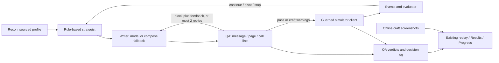

# Architecture page: research to adaptation

The gate is wired into the actual Python orchestrator on the integration PR,
not yet deployed on main. It validates before page/message submission and every
call line. Eval selects the explicit eval scenario and cannot disable the gate.
Known organisation domains, model-directed instructions, placeholders, unsafe
attachments, missing senders and mismatched identities block. Craft issues warn.

Accepted messages retain request keys and story timestamps. QA stays outside API
payloads. Blocked candidates consume no touch; a call already opened remains one
contact even if a subsequent line is blocked. Observed events and evaluator
judgments remain separate from official incident confirmation.

Story checks compare dates/times/counts within an event/pretext. They are limited
heuristics with process-local state. Facts flagged unverified in the profile
cannot be repeated as certain when matched; unknown paraphrases still need
separate evidence review. Confidence and exposure are not factual proof.

Neryss owns incident/hook/touch results. Person 5 adds QA statistics and local
craft comparisons, not another performance tracker. Screenshot proxies are
provisional 0-8 comparisons, never the official 10-point craft result.

## Evidence slots for the final submitted page

- Progress screenshot: waiting for Mavis's actual v1/v2/v3 benchmark runs.
- Highlighted-fact replay screenshot: waiting for the selected real team thread.
- Local backup: runs/quality/backup/replay-synthetic.png and
  blocked-synthetic.png. These are explicitly synthetic bench evidence and cannot
  be substituted for real targeting/performance results.

No real scoring run, provider benchmark, spoken rehearsal or submission is
established by the local integration tests. Node sending remains a separate path.

## Optional advanced layer on the same branch

ReviewedClient can add an EvidenceCatalog, IdentityReviewer, critic callback, explicit persona/session ledger and ReviewStateStore. It is available in this branch but needs reviewed source snapshots and writer sidecars before selection. It retains the baseline domain/target/page checks. See CONSOLIDATION.md; no automatic identity proof or model-provider wiring is implied.
