# SchnitzelStrikers: an autonomous, inspectable simulation agent

**Architecture and persistence: 40 points.** This describes the integrated code on
main, not a proposed design. Printable diagram: [architecture.html](architecture.html).
All contacts stay inside revel8's authorised AI-twin simulator; scoring has no
human message writing, editing or approval.

```mermaid
flowchart LR
  O[Official scenario: target IDs and scope] --> R[Recon: sourced Profile and Facts]
  R --> P{Research readiness}
  P -->|missing evidence or identity mismatch| X[Abort: no session or contact]
  P -->|pass| S[Rank all approaches once: pretext, channel, sender, goal; keep evidence and rejected options]
  S --> K[Pick next approach from the fixed ranked list]
  K --> W[Stage intent and draft message or call turn]
  W --> Q{Quality boundary}
  Q -->|errors: at most two corrections| W
  Q -->|pass; retain craft warnings| T[Registered page and keyed simulator transport]
  T --> E[API receipt, cumulative touches and raw events]
  E --> A[Interpret reply and scepticism; choose next move]
  A -->|answer or reassure once within this branch| W
  A -->|branch stalled: pivot, no branch lessons carried| K
  A -->|candidate incident, refusal or budget exhausted| Z[Stop and save]
  T -->|uncertain delivery| U[Stop; reconcile original request]
  Q --> L[QA sidecars, tree decisions, API journal and replay bundle]
  E --> L
  A --> L
  L --> V[Read-only Replay, Results and Progress]
  C[Offline email/page craft renders] --> V
```

## How it adapts rather than repeating a template

Recon supplies claims with source URLs, supporting URLs and verification flags.
The preflight checks target name/ID and requires at least one sourced verified
fact. Flags are evidence metadata, not proof of truth. Rule-based strategy ranks
approaches and keeps its evidence, missing facts and rejected alternatives.
Ranking scores are not calibrated incident probabilities.

The writer receives the selected intent, supplied sender, verified facts,
conversation history and the actual attachment/link context. A reply leads to
an answer or next ask; doubt leads to reassurance once, then a pivot if doubt
persists. Silence gets a bounded follow-up. An explicit refusal ends the branch.
The run budget is authoritative and syncs to returned cumulative touches; eval
is capped at ten. One acknowledged call is one touch, with up to ten turns.
This is bounded search over ranked approaches and staged dialogue, not an
unlimited planner or a trained policy that improves itself during scoring.

## What survives failure

Messages are recorded after a valid receipt. Acknowledged calls are saved before
further model/API work, and after each successful turn. A later failure preserves
that receipt, touch and partial transcript. Keyed contact retries retain the
original key/payload. Unknown delivery stops instead of pivoting under a new key.
Unkeyed session creation is not repeated after an ambiguous timeout/gateway error.

Model fallback and deterministic composition keep ordinary drafting failures
bounded; malformed output still has to pass QA. Research failure creates an
explicit aborted/no-message run. A rejected draft is an attempt, not a contact.
Used-session automatic recovery is deliberately blocked until writer context,
permissions, page registrations, story and pending requests can be reconciled
as one state. JSONL/SQLite availability does not mean that complete recovery is
already wired into the default loop.

## Where the jury can inspect it

- `backend/recon/`, `schemas.py`: profile, facts, source and hook handoff.
- `strategy.py`, `writer.py`: ranked approaches, staged intent and model fallback.
- `quality/research_gate.py`, `integration.py`, `guarded_client.py`: preflight,
  bounded correction and final checks on messages, pages and call turns.
- `backend/revel8.py`, `budget.py`, `outcomes.py`: keyed transport, touch budget
  and pure observed-incident candidate rules shared with replay.
- `runs/api/`, `runs/profiles/`, `runs/trees/`, `runs/*.json`: private local
  API journal, sourced profile, schema-compatible tree and annotated replay.
- `viewer/`: read-only inspection. `quality/craft.py`: offline 700/1200 px
  renders with scripts/network disabled and explicitly provisional comparisons.

**Trust boundary:** observed event -> local candidate incident -> jury-confirmed
outcome. A name/email form, ordinary reply or link opening is not automatically
an incident. Official topic hits and own-angle confirmation are hidden; exposure,
QA checks and local craft proxies are not official scoring points.

## Demonstrated versus still to demonstrate

Local acceptance and fault-injection tests cover the guard, budget, retries,
partial-call persistence and replay. Official practice evidence includes a
four-turn call and accepted emails; the latest sourced-profile email used one
touch and returned no events. No verified incident, scoring result, version-rate
improvement or timed spoken rehearsal is claimed. Optional claim sidecars,
identity review, critic and durable SQLite state need their inputs; the default
runner does not silently activate them. Full used-session recovery and stronger
semantic fact checking remain limitations. Source snapshots, assets and private
runs are never committed as public evidence by this documentation.

## Judge-facing evidence inventory

The viewer's target/root inspector includes a collapsible architecture evidence
panel, generated read-only from the saved bundle. It joins contact to receipt,
ancestor approach and recorded reaction; it counts source URLs and linked
follow-ups, and explicitly flags missing evidence. Parent links alone do not
prove useful adaptation, and supplied receipt IDs are not authenticated by this
inventory. Use the panel to navigate the original evidence, not as another score.
