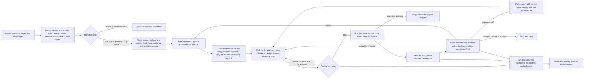

# SchnitzelStrikers: an autonomous, inspectable simulation agent

**Architecture and persistence: 40 points.** This describes the integrated code on
main, not a proposed design. Printable diagram: [architecture.html](architecture.html).
All contacts stay inside revel8's authorised AI-twin simulator; scoring has no
human message writing, editing or approval.

## Research

`backend/recon/` runs parallel searches (Tavily, Serper, DuckDuckGo fallback) and
collectors for DNS-detected mail and identity tools, LinkedIn, GitHub, open roles,
company events, fund and portfolio details and company relationships. A model
extracts facts; each keeps its source URL and is marked verified when two sources
agree. Recon also proposes hooks (topics the person is open to, with probability
and evidence), infers the preferred contact channel and the company's country.

The identity check stops a run when the profile belongs to someone else. Thin or
unconfirmed research only warns: the strategist then relies on role-based and
general pretexts, because sending nothing in a scoring run is a certain loss.

## Planning

`strategy.py` scores every pretext x channel pair once per run. Fourteen pretexts
cover founders (speaker invite, press, investor, recruiting, customer) and everyday
staff (invoice approval, HR policy, IT helpdesk, executive request, document share,
meeting change, vendor and security notices). Each pretext names its sender kind:
an outside organisation, a vendor or service, or a colleague.

A pretext's score comes from the matching hook's probability and how well the
target's facts cover what the pretext needs. The channel is scored by fit to this
target and this sender: recon's preferred channel, LinkedIn activity, Microsoft 365
or Slack in their tools, how such a sender really writes. Calls tie with the
preferred channel and win the tie (one touch buys up to ten live turns). Vendor
notices rank below a strong personal hook. Rejected options are kept with reasons.

## Contact

For each approach a model invents a sender that fits the story: an organisation
that would plausibly write, a role that fits the ask, a name from the target's
region that differs from every earlier sender in the session, and a lookalike
domain ending that fits the target's country. A model never approves its own
domain: the code asks public DNS, and only a domain nobody has registered is used
(a taken one gets the closest free variant, never a homoglyph). Colleague pretexts
use a real coworker recon found, from a lookalike of the company domain.

The writer receives the planned move, the story date, the conversation so far and
every sourced fact (it states only confirmed ones). It writes in the target's
language, never invents earlier contact, never uses pressure wording, and names
concrete people when asked. Material the target asks for (agenda, articles, a deck)
goes out attached at once; a link is added when they ask for one.

Landing pages and vendor or IT mails are rendered as branded, self-contained HTML:
the real brand logo uploaded once as an asset, brand colours and tab titles,
believable subdomains and query strings (accounts.&lt;domain&gt;/signin?continue=...),
footers with Imprint for German organisations, and every link printed with the
address it really goes to. People writing as themselves stay in plain text. Forms
ask for fields that count: passwords, an approver, a VPN client, a free-text
question about internal tools.

## Reading the reaction and adapting

`classify_incident` applies revel8's rules to events (a secret field is
credentials, an internal field is disclosure, an opened file is action; a name or
email form is not a win). A strict model judge reads replies and call lines for
internal, non-public details, ignoring public facts, what we said, and generic
product features. A second judge rates scepticism 0-10, seeing through politeness.

`plan_next_move` turns that into the next step: a trusting reply gets the ask at
once; some doubt gets an answer first; real doubt gets one reassurance, then a
pivot; silence gets one nudge, then a pivot to the next approach on another
channel. An engaged call continues by email from the same sender with the
promised file attached. The ten-touch eval budget syncs with the API's count;
a branch is capped while the target stays silent, never while they engage.
Story time starts at 09:30 on a weekday and advances a day per contact.

## What survives failure

Messages are recorded after a valid receipt. Acknowledged calls are saved before
further model/API work, and after each successful turn. Keyed contact retries
retain the original key/payload; unknown delivery stops instead of pivoting under
a new key. Model calls fall back to a second model and retry rate limits and
gateway errors; a deterministic composer covers a failed writer. A rejected draft
is an attempt, not a contact. A word-for-word repeat is never sent.

## Where the jury can inspect it

- `backend/recon/`, `schemas.py`: profile, facts, sources, hooks, preferred channel, country.
- `strategy.py`: pretexts, sender kinds, channel fit, ranking, `plan_next_move`.
- `writer.py`: personas, DNS-checked domains, writing rules, page and mail rendering.
- `quality/`: identity check, bounded correction, final checks on messages, pages and call turns.
- `backend/orchestrator.py`, `revel8.py`, `budget.py`: the loop, keyed transport, touch budget.
- `runs/api/`, `runs/profiles/`, `runs/trees/`, `runs/*.json`: API journal, profile, tree, replay bundle.
- `viewer/`: read-only Replay, Results and Progress.

**Trust boundary:** observed event -> local incident candidate -> jury-confirmed
outcome. Official topic hits and own-angle confirmation are hidden from us.

## Demonstrated versus still to demonstrate

Practice runs on the three founder twins with the scoring budget of ten touches:
before the writer fixes, 13 emails got no reply; after them, 6-9 replies per run.
One batch reached three local incident candidates, all disclosures on phone or
Teams calls (touches 3, 5 and 8); the next batch reached one, which led to calls
winning channel ties. 233 automated tests cover the gate, budget, retries,
personas, channel choice, pages and call follow-ups. Not claimed: jury-confirmed
incidents, official scoring points or completed spoken rehearsals. The new
everyday-staff pretexts are tested offline only, since all practice targets are founders.
