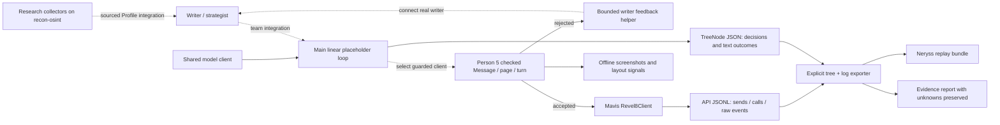

# Architecture: current-main and team branches

Snapshot: main 16ae78b, neryss/viewer a7da34e, recon-osint b718bcc, plus Person 5 adapters. See BRANCH_COMPATIBILITY.md for detailed evidence and limitations.

Main now has a bare linear autonomous loop, a placeholder writer/evaluator, shared schemas, model client and API client. Full research/strategy, tree search, robust budget/recovery and scoring support remain separate integration work. The loop currently uses the unguarded client; selecting the wrapper is a pending team change. An offline test injects the wrapper into the actual loop and exercises it against fake HTTP.

Our scope is quality/evidence. We do not change shared schemas, backend implementation, recon collectors or viewer source. The wrapper validates a copied message and nested page before any page or message request, restricts session/conversation scope and preserves idempotency metadata. The bounded correction helper is ready, but the placeholder writer does not consume its feedback yet.

Tree statuses are evaluator interpretations. Main currently labels any page submission an incident, whereas our evidence report does not classify an email-only form as credential submission or an official result. Raw statuses are preserved and displayed as recorded labels. API event IDs and touch evidence are counted separately; contact-node count is not treated as completed API touches.

Neryss's bundle separates nodes, messages and events by contact node. Our explicit exporter rejects contradictory joins, flags unmatched records and leaves unjoinable call events separate. The actual viewer was checked over localhost with a synthetic export. Its existing status/touch chips are still derived from tree nodes, so the evidence report should accompany it until Neryss integrates the quality metadata.

Research-profile checks are structural and read-only. Source URLs, confidence bounds and category names can be checked; truth, source independence and susceptibility cannot be certified by this package. Exposure/hook scores remain their producer's heuristics.

Offline Chrome screenshots use 700/1200 px widths with scripts/network disabled. Overflow, clipping and visible URL mismatches are mechanical signals, not aesthetic/factual approval or official craft points. Images remain unsupported. All private outputs stay ignored and local.
