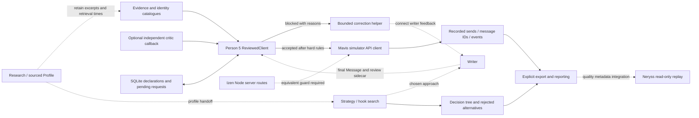

# Architecture - Person 5 and current team interfaces

Snapshot: main 9565b48, recon 333b973, Izen aa84835, profile replay 2f1f853.
Dashed arrows are integration work, not claims of completed deployment.

## What exists

Main has shared profiles/messages, model/API clients and tree-search orchestration.
Its agent hooks still include placeholders. Recon and viewer branches add separate
collectors and profile replay. The supplied plan's FastAPI/Next.js stack is a
proposal: current Strategy Lab uses a Node HTTP server, and replay uses a Python
read-only server.

Person 5 supplies an opt-in quality boundary, bounded correction, writer adapter,
evidence/identity checks, critic-output checks, consistency ledger, optional
SQLite state, results exporter and offline renderer. Shared schemas are unchanged.

## Before sending

The caller supplies authorised practice session and domain context. Hard rules
run before the optional critic. The final copied message is bound to a review
digest. Declared target facts require approved claim IDs, supporting excerpts
and original retrieval times. Identity evidence is separate from official API
eligibility; neither a name mention nor a supported match proves existence or
current employment.

The ledger checks session promises and persona declarations across messages,
attached pages and calls. With SQLite enabled, a reservation reaches disk before
transport. Missing/malformed responses stay unresolved. Acknowledgement commits
declarations. Restarts must not forget uncertain sends or repeat delivered keys.
Active conversation resume remains restricted; call turns are not new contacts.

## Evidence and limits

Observed API events, evaluator interpretations and official outcomes are distinct.
A reply is not automatically disclosure. Tree ordinals do not establish touches.
Explicit export joins leave unsupported timing and attribution unknown. Bench
ground truth, seeded profiles and live practice must remain separately labelled.

Team Python/Node routes must select these guards explicitly. The critic callback
needs its own provider integration and may misclassify facts. Recon must retain
snapshots/timestamps; activity dates and confidence are not substitutes. A safe
fetcher/SSRF policy remains recon work; these inspectors perform no web requests.

Offline Chrome checks disable scripts/network. Layout signals are not official
craft points; uploaded images remain a limitation. Real thread selection, two
spoken rehearsals and final submission still need the operator and teammates.
