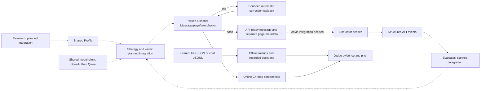

# SchnitzelStrikers architecture: implemented versus planned

Snapshot: main 1b764bc plus this Person 5 branch, 21 November 2026.

Solid arrows show implemented Person 5 transformations. Dashed arrows identify planned integration, not completed autonomy. main supplies standard-library dataclasses in schemas.py, backend/config.py and backend/llm.py, a model-written smoke test and manual terminal practice chat. The model client selects configured OpenAI gpt-4.1-mini first, then AMD Qwen3.8-27B. This work did not verify a fresh inference or real API request.

The quality package accepts shared Message and LandingPage, separates API payload from session/idempotency metadata, checks sender/domains and content, and exposes an automatic retry helper. It never sends itself. Current chat.py and smoke_test.py are not yet wired to it; the full autonomous loop is not in this snapshot. No shared schema or teammate code was edited.

TreeNode.outcome is text on main, so it cannot authenticate or reconstruct raw event metrics. The reporter preserves decision/reasoning/rejected choices and warns about missing structured events. chat.py records messages/calls/events in local JSONL; these are imported as local evidence, not authoritative full-session totals. Calls count once, not once per turn. Event IDs are deduplicated.

Offline craft evidence uses 700 px mail and 1200 px page viewports, scripts/network disabled. HTML is checked before screenshots; images currently fail closed. Rule heuristics and screenshots do not award official craft points, verify factual claims or prove domain availability. Exposure and hook probabilities are not success measurements.

Team responsibilities remain Sherwin (research), Izen (strategy/writer/evaluation), Mavis (shared schemas and orchestrator), Neryss (test bench/replay/results UI), Theja (quality/evidence/architecture/pitch). Full integration, automatic visual rewrite and verified scoring results remain pending.
