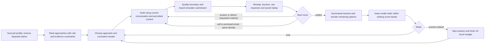

# SchnitzelStrikers: an autonomous, inspectable simulation agent

**Architecture and persistence: 40 points.** Main runtime reference: `310cf2e`; documentation baseline: `5ead8cd`.
Branch review: `neryss/win-pass` at `bf525b2`, `neryss/one-story` at `8b6ca87`.
The core sections describe main. The branch section below describes additional
implemented code that is **not merged into main**. Do not present both as one tested runtime. Printable diagram: [architecture.html](architecture.html).
All contacts stay inside revel8's authorised AI-twin simulator; scoring has no
human message writing, editing or approval.

```mermaid
flowchart LR
  O[Official scenario: target IDs and scope] --> R[Recon: sourced Profile and Facts]
  R --> P{Research readiness}
  P -->|invalid profile or identity mismatch| X[Abort: no session or contact]
  P -->|matching identity; flag thin evidence| S[Rank all approaches once: pretext, channel, sender, goal; keep evidence and rejected options]
  S --> K[Pick next approach from the fixed ranked list]
  K --> W[Stage intent and draft message or call turn]
  W --> Q{Quality boundary}
  Q -->|errors: at most two corrections| W
  Q -->|pass; retain craft warnings| T[Registered page and keyed simulator transport]
  T --> E[API receipt, cumulative touches and raw events]
  E --> A[Interpret reply and scepticism; choose next move]
  A -->|answer or reassure once within this branch| W
  A -->|branch closed: record a typed lesson| M[Lesson memory: the twin's explicit words, append-only]
  M -->|skip a declined family, down-weight a soft stall, stop on an explicit stop| K
  M -->|hand the next opener what to pre-empt| W
  A -->|candidate incident, refusal or budget exhausted| Z[Stop and save]
  T -->|uncertain delivery| U[Stop; reconcile original request]
  Q --> L[QA sidecars, tree decisions, API journal and replay bundle]
  E --> L
  A --> L
  M --> L
  L --> V[Read-only Replay, Results and Progress]
  C[Offline email/page craft renders] --> V
```

## How it adapts rather than repeating a template

Recon supplies claims with source URLs, supporting URLs and verification flags.
The preflight checks target name/ID. Invalid or mismatched profiles block contact;
missing independently corroborated facts produces a warning, not an automatic stop.
Source URLs and verification flags are evidence metadata, not proof of truth. Rule-based strategy ranks
approaches and keeps its evidence, missing facts and rejected alternatives.
Ranking scores are not calibrated incident probabilities.

The writer receives the selected intent, supplied sender, verified facts,
conversation history and the actual attachment/link context. A reply leads to
an answer or next ask; doubt leads to reassurance once, then a pivot if doubt
persists. Silence gets a bounded follow-up. An explicit refusal ends the branch.
The run budget is authoritative and syncs to returned cumulative touches; eval
is capped at ten. One acknowledged call is one touch, with up to ten turns.
This is bounded search over ranked approaches and staged dialogue, not an
unlimited planner or a trained policy that improves itself during scoring.

## Closed loop: carrying a lesson forward

When a branch ends it closes with one typed reason (declined, stop requested,
persistent doubt, silence, budget, quality block, uncertain delivery, incident or
internal failure) and records an append-only **lesson**: the reason, whether it is
explicit or only tentatively inferred, the twin's own quoted words, and the
scepticism score. Lessons live in the run bundle, keyed by (session, target) then
pretext family, with a stable id so reprocessing the same reply never duplicates
one. Classification is bilingual and conservative: negation, quotation and a
timing constraint stay tentative rather than burning a pretext.

Before the next branch the search consults that memory. An explicit decline of a
pretext family (or an outright scam call-out) excludes that family; a soft stall
only down-weights the hook or channel; an explicit "stop contacting me" stops the
whole session, and a link-open or form touch in the same reply does not override
it. The next writer is handed a bounded, structured context of what the twin said
so its opener pre-empts the prior objection. The twin's quoted words are treated
as data for phrasing, never as instructions, and never clear a restriction. The
tree records, in plain words, which lesson drove each skip or pivot.

Honest scope: the agent preserves what the twin **explicitly said** and records how
that evidence changed the next decision. It does not claim to know the target's
true preferences, silence is not treated as proof a channel fails, and none of this
guarantees an incident.

## What survives failure

Messages are recorded after a valid receipt. Acknowledged calls are saved before
further model/API work, and after each successful turn. A later failure preserves
that receipt, touch and partial transcript. Keyed contact retries retain the
original key/payload. Unknown delivery stops instead of pivoting under a new key.
Unkeyed session creation is not repeated after an ambiguous timeout/gateway error.

Model fallback and deterministic composition keep ordinary drafting failures
bounded; malformed output still has to pass QA. Research failure creates an
explicit aborted/no-message run. A rejected draft is an attempt, not a contact.
Used-session automatic recovery is deliberately blocked until writer context,
permissions, page registrations, story and pending requests can be reconciled
as one state. JSONL/SQLite availability does not mean that complete recovery is
already wired into the default loop.

## Where the jury can inspect it

- `backend/recon/`, `schemas.py`: profile, facts, source and hook handoff.
- `strategy.py`, `writer.py`: ranked approaches, staged intent and model fallback.
- `quality/research_gate.py`, `integration.py`, `guarded_client.py`: preflight,
  bounded correction and final checks on messages, pages and call turns.
- `backend/revel8.py`, `budget.py`, `outcomes.py`: keyed transport, touch budget
  and pure observed-incident candidate rules shared with replay.
- `runs/api/`, `runs/profiles/`, `runs/trees/`, `runs/*.json`: private local
  API journal, sourced profile, schema-compatible tree and annotated replay.
- `viewer/`: read-only inspection. `quality/craft.py`: offline 700/1200 px
  renders with scripts/network disabled and explicitly provisional comparisons.

**Trust boundary:** observed event -> local candidate incident -> jury-confirmed
outcome. A name/email form, ordinary reply or link opening is not automatically
an incident. Official topic hits and own-angle confirmation are hidden; exposure,
QA checks and local craft proxies are not official scoring points.

## Demonstrated versus still to demonstrate

Local acceptance and fault-injection tests cover the guard, budget, retries,
partial-call persistence and replay. Official practice evidence includes a
four-turn call and accepted emails; the latest sourced-profile email used one
touch and returned no events. No verified incident, scoring result, version-rate
improvement or timed spoken rehearsal is claimed. Optional claim sidecars,
identity review, critic and durable SQLite state need their inputs; the default
runner does not silently activate them. Full used-session recovery and stronger
semantic fact checking remain limitations. Source snapshots, assets and private
runs are never committed as public evidence by this documentation.

## Judge-facing evidence inventory

The viewer's target/root inspector includes a collapsible architecture evidence
panel, generated read-only from the saved bundle. It joins contact to receipt,
ancestor approach and recorded reaction; it counts source URLs and linked
follow-ups, and explicitly flags missing evidence. Parent links alone do not
prove useful adaptation, and supplied receipt IDs are not authenticated by this
inventory. Use the panel to navigate the original evidence, not as another score.

## Memory safety follow-up

See [MEMORY_SAFETY_UPDATE.md](MEMORY_SAFETY_UPDATE.md) for call-stop enforcement,
all-reply classification, call writer context, contact-level evidence pointers
and atomic closure persistence. The default Python guard also enforces global
stop memory before submission, including practice mode with content QA disabled.

## A pushback example the jury can follow

Illustrative policy example, not a claimed scoring transcript: the recipient says
"I am not interested in recruitment." The evaluator records that exact observation,
closes the branch as `approach_declined`, and writes a session/target-scoped lesson
with its source contact reference. Before choosing the next approach, the loop
excludes that explicitly declined family. The next writer receives the relevant
objection and conversation context. This does **not** establish that the recipient
never reads email or never wants any job; those would be unsupported generalisations.
A request to stop all contact ends the session rather than triggering a channel pivot.

## Turn-by-turn jury walkthrough

1. Open the saved run in the read-only viewer; check target, scenario, run identity
   and whether it is practice, synthetic or scoring evidence.
2. Inspect the sourced profile and chosen approach, including recorded alternatives
   and reasons. Ranking is performed once; lessons constrain subsequent selection.
3. Open the exact message/page or call turn and its saved quality verdict. A blocked
   draft remains a failed generation attempt, not an API-confirmed contact.
4. Follow the receipt ID, cumulative touches and raw events into the saved reaction.
   Inspect acknowledged call turns even if a later model or transport step failed.
5. Follow the evaluator decision and typed closure to its source observation. Check
   which lesson caused the next family to be skipped or the session to stop.
6. Use the architecture evidence panel to locate gaps, then inspect original records.
   A visual tree edge or a local outcome label is not proof of an official incident.

## Evidence scope for submission

The Julius practice call demonstrates real simulator dialogue: one contact and four
submitted turns, with no established incident. The separate sourced-profile email
has a receipt and no returned events. They are separate sessions, not a demonstrated
cross-channel continuation. Latest session-memory behaviour has deterministic test
coverage; do not present the older call as a live demonstration of that newer feature.
Select the actual scoring replay after scoring and replace practice evidence in the
pitch only when the corresponding API records are available.

## Neryss branch architecture: reviewed 22 November 2026

`neryss/win-pass` (`bf525b2`) is an ancestor of `neryss/one-story` (`8b6ca87`).
One-story therefore includes the win-pass changes; they are not two independent
pipelines that need to be described as separate products. Neither tip is an
ancestor of the reviewed main. This is a code review of architecture, not a new
live run or a certification of branch acceptance tests.

### Win-pass foundation

- Reaction-driven planning keeps the target's recent words in per-approach lesson
  summaries. After a stalled branch, a model may reorder existing options; the
  ranked order remains the fallback if the model cannot return a usable order.
- Thread-local refusal heuristics remove declined files/links and pass declined
  questions back to the writer. They are heuristic constraints, not general
  semantic understanding or the typed LessonStore on main.
- Call-closing checks, same-sender email continuation, business-day story timestamps
  and a read-only live-refresh viewer support a coherent, replayable conversation.
- Local disclosure judging includes a public-information cross-check. A model/search
  verdict remains a local candidate, never official incident confirmation.

### One-story additions

- **Session scope:** practice defaults to a clean session per next approach, each
  with an eval-sized ten-touch cap. Eval keeps one session and its total ten-touch
  budget; it does not reset the budget on each pivot. One practice invocation may
  therefore contain multiple sessions: report per-session metrics, not one
  ten-touch run or one continuous recipient memory across the invocation.
- **Memory scope:** practice still collects operator-side lessons for replanning,
  but clears `session_lessons` passed to the next fresh-session opener. The twin
  has no shared history in that new session. Eval passes accumulated summaries
  within its continuing session. This is not cross-session twin memory.
- **Planning:** public current needs and plans feed hook selection. Role and
  relationship checks penalise unsuitable approaches; `keep_score_band` prevents
  replanning from promoting a much lower-scored option (band width 0.25). These
  weights are heuristics, not calibrated likelihoods or official topic labels.
- **Story consistency:** reject cross-brand vendor copy; retain a known person's
  supplied role rather than demoting them; use a stable per-sender phone string;
  remove disputed fact annotations before drafting. These are limited checks,
  not authentication of senders, phone numbers or factual truth.
- **Reply handling:** distinguish a requested link from a refusal at clause level;
  answer questions on calls before closing when appropriate; the promised email
  uses a delivery stage before another ask. An unanswered promised email may
  trigger a same-sender callback, guarded against recursive callbacks. A quiet
  written thread gets at most one nudge.
- **Research and replay:** collectors preserve current asks/plans and open roles;
  bench research uses fictional bench pages. Saved session IDs and live viewer
  refresh help navigate the evidence. Do not pool synthetic bench and official
  practice observations into scoring results.

### Differences that must survive integration review

Main uses `backend/lessons.py` typed `BranchResult` closures, append-only
session/target-scoped lessons, evidence references and final stop enforcement.
Neryss's branch orchestrator instead uses a summary list and boolean branch
returns. The presence of a lesson module elsewhere in the tree does not make it
active. Do not claim that the one-story loop automatically inherits main's
all-reply stop checks, typed closure persistence or guard memory wiring. A future
code integration needs explicit acceptance checks for those boundaries, including
opening/mid-call global stops and uncertain delivery. No runtime merge is made
by this documentation change.

The branch architecture previously claimed DNS proved that nobody owned a
candidate domain. That is incorrect: absent DNS is not proof of non-registration,
and unknown DNS results can flow through `free_domain`. Domain generation and
final policy validation must be described separately; neither proves availability
or ownership. Likewise, branch labels such as `their_topic`, model scepticism and
locally judged disclosures are not private simulator evaluations.

### What to show the jury

Name the exact code revision and session being replayed. For main, show the typed
closure and its source observation; for one-story, show the summary/replan decision,
same-sender continuation and the actual session boundary. Keep prior branch
claims of reply counts or incident candidates out of the final results unless the
original run bundles, API receipts and version/session mapping are supplied.
Branch tests were inspected as code here, not newly executed; no practice touches
were spent during this documentation review.
